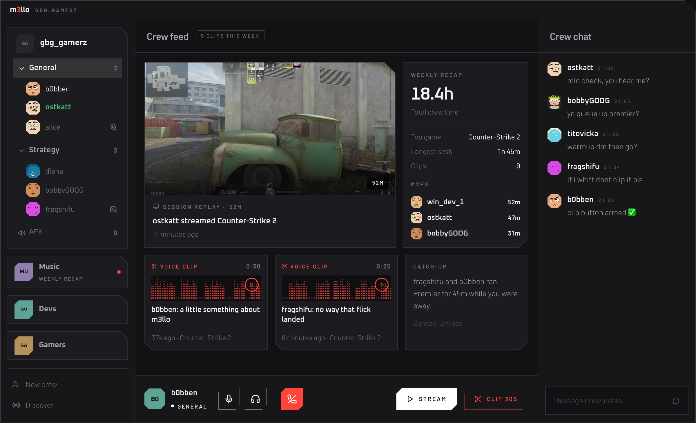

<h1 align="center">m3llo</h1>

<p align="center">
  <strong>Voice, streaming, and proof last night's clutch actually happened.</strong>
</p>

<p align="center">
  <a href="https://m3llo.app">m3llo.app</a> &nbsp;·&nbsp;
  <a href="https://m3llo.app/vs/">Compare</a> &nbsp;·&nbsp;
  <a href="#download">Download</a> &nbsp;·&nbsp;
  <a href="#for-developers">For developers</a> &nbsp;·&nbsp;
  <a href="#self-hosting">Self-hosting</a>
</p>

<p align="center">
  
  
  
</p>

---

<p align="center">
  
</p>

## What is m3llo

m3llo is the app for your gaming crew. Voice and streams while you play, a clip button for the plays worth keeping, and a crew feed that holds on to all of it: the session, the clips, who showed up, who carried, and a weekly recap of how it went.

Built for the people you actually play with. Five of you, or fifty, who know each other by name. If you run a big community on Discord, this is not for you.

- **Voice** that stays out of the way. Low latency, neural noise cancellation.
- **Stream** your screen at 1080p60. Hardware encoded on your GPU, your CPU stays with your game.
- **Chat** with markdown, replies, reactions, GIFs.
- **Crew feed** with clips, sessions, and a weekly recap. Come back tomorrow, the crew is still there.

For the longer version see **[m3llo.app](https://m3llo.app)** or the **[honest comparison](https://m3llo.app/vs/)** against Discord, TeamSpeak, Guilded, and Medal.

Made in Europe.

---

## Download

Grab the latest build for your platform:

<p align="center">
  <a href="https://github.com/mollohq/mello/releases/latest/download/m3llo-win-x64-stable-Setup.exe">
    
  </a>
  &nbsp;
  <a href="https://github.com/mollohq/mello/releases/latest/download/m3llo-osx-arm64-stable-Setup.pkg">
    
  </a>
  &nbsp;
  <a href="https://github.com/mollohq/mello/releases/latest/download/m3llo-linux-x64-stable.AppImage">
    
  </a>
</p>

All releases, changelogs, and previous versions on the [Releases page](https://github.com/mollohq/mello/releases).

---

## Community

We hang out on m3llo itself.

- **m3llo crew:** [m3llo.app/join/LAWK-N24N](https://m3llo.app/join/LAWK-N24N)
- **Bluesky:** [@m3llo.app](https://bsky.app/profile/m3llo.app)
- **Reddit:** [r/m3llo_app](https://reddit.com/r/m3llo_app)
- **Threads:** [@m3llo.app](https://www.threads.com/@m3llo.app)
- **Issues:** [GitHub Issues](https://github.com/mollohq/mello/issues) for bugs and feature requests

---

# For developers

The rest of this README is for people who want to build m3llo from source, contribute, or run their own instance.

## Guiding principles

- **Performance is the feature.** Targets: `<100MB install` · `<80MB RAM in active voice` · `1080p60 stream` · `<60ms WAN latency`
- **Self-hostable.** The client, backend and SFU are open source. Run your own instance with no dependency on our infrastructure.
- **Your own SFU.** Voice and streams run through [mello-sfu](https://github.com/mollohq/mello-sfu). Run ours in the EU or host it yourself.
- **UX matters as much as code.** Follow the design system in [`designs/design-system.html`](designs/design-system.html).

## Build from source

Building and running is supported on Windows, macOS and Linux.

**Prerequisites:**

- Rust 1.75+
- CMake 3.20+
- Visual Studio 2022 (Windows) with C++ workload, or Xcode (macOS)
- Docker (for backend)

```bash
# Clone
git clone https://github.com/mollohq/mello.git
cd mello

# Start backend
cd backend && docker compose up -d

# Run client
cd .. && cargo run -p mello-client
```

Nakama console at `http://localhost:7351` (admin / adminadmin)

Full setup and platform-specific notes in [`specs/05-GETTING-STARTED.md`](./specs/05-GETTING-STARTED.md).

## Architecture

```
┌─────────────────────────────────────────────────────────────┐
│                         CLIENT                              │
│                                                             │
│   ┌───────────┐    ┌─────────────┐    ┌──────────────┐      │
│   │  Slint UI │    │ mello-core  │    │  libmello    │      │
│   │  (Rust)   │◄──►│  (Rust)     │◄──►│  (C++)       │      │
│   │           │    │             │    │              │      │
│   │  Native   │    │  App logic  │    │  Voice       │      │
│   │  UI       │    │  Nakama     │    │  Stream      │      │
│   │           │    │  client     │    │  Transport   │      │
│   └───────────┘    └─────────────┘    └──────────────┘      │
└─────────────────────────────────────────────────────────────┘
                              │
                              ▼
┌─────────────────────────────────────────────────────────────┐
│                         BACKEND                             │
│          Nakama (Auth, Chat, Presence, SFU tokens)          │
│                        PostgreSQL                           │
└─────────────────────────────────────────────────────────────┘
```

Deep dives live in [`/specs`](./specs). Start with [`00-ARCHITECTURE.md`](./specs/00-ARCHITECTURE.md), then the pipeline specs for voice, video, streaming, and networking.

### Stack

| Component | Technology | Notes |
|-----------|------------|-------|
| UI | [Slint](https://slint.dev) | Rust-native |
| Client logic | Rust | mello-core |
| Media layer | C++ | libmello |
| Transport | [libdatachannel](https://github.com/paullouisageneau/libdatachannel) | WebRTC to the SFU |
| Audio codec | Opus | BSD licensed |
| Noise suppression | RNNoise | BSD licensed |
| Echo cancellation | WebRTC AEC3 + AGC2 | BSD licensed |
| Voice activity | Silero VAD | MIT licensed |
| Video decode | OpenH264 + dav1d | BSD licensed, no GPL |
| Backend | [Nakama](https://heroiclabs.com/nakama/) + PostgreSQL | Apache 2.0 |

## Contributing

Contributions are welcome.

**AI-assisted contributions are welcome.** We use AI tooling ourselves. Just make sure the output follows CLAUDE.md, comes with a proper spec, and you've actually read and understood what you're submitting. We review the result, not the method.

**Before opening a PR, read [CLAUDE.md](./CLAUDE.md).** It covers how the codebase is structured, what the agents expect, and how we work. Ignoring it wastes everyone's time.

**Every new feature needs a spec.** Look at [`/specs`](./specs) to see the format. A spec doesn't have to be long, but it needs to cover what, why, and the key constraints. No spec, no merge.

- Bugs: open an [issue](https://github.com/mollohq/mello/issues)
- Ideas: start a [discussion](https://github.com/mollohq/mello/discussions)
- Code: PRs welcome, read specs first
- Docs: always needed

Run the gate before you push.

```bash
./scripts/check.sh
```

---

## Self-hosting

The client, backend and SFU are open source. For those of you who never really got over losing Ventrilo. For the tinkerers who need another project for that dusty Raspberry Pi in the drawer. We're one of you ourselves.

Full setup instructions in [/docs/self-hosting.md](./docs/self-hosting.md).

### Self-hosted vs m3llo.app

|   | Self-hosted | m3llo.app |
|---|---|---|
| Voice and streams | Your own SFU | Hosted SFU in the EU |
| All other features | Identical | Identical |
| Your data | Stays on your hardware | EU-based, GDPR |
| Setup | Your own hardware | Zero setup |
| Cost | Free | Free, optional add-ons |

Same client, same features. The difference is who runs the backend and the SFU.

---

## License

Apache 2.0. See [LICENSE](LICENSE).

---

<p align="center">
  <a href="https://github.com/mollohq">
    <picture>
      <source media="(prefers-color-scheme: dark)" srcset=".github/assets/mollo-tech-white.png">
      <source media="(prefers-color-scheme: light)" srcset=".github/assets/mollo-tech-black.png">
      
    </picture>
  </a>
  <br/>
  <sub>Made in Göteborg, Sweden by <a href="https://github.com/mollohq">Mollo Tech AB</a></sub>
</p>
